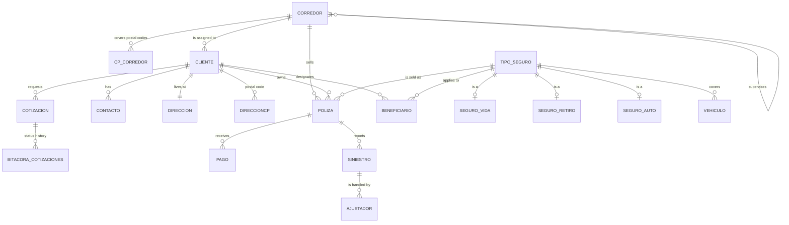

# Insurance Management System — SQL Server Database


A relational database for a multi-line insurance company, built on **Microsoft SQL Server**. It covers the full business flow — clients, quotes, policies, payments, claims and the sales force — with business rules enforced directly in the database through constraints, triggers, functions, stored procedures and role-based security.

> Team project for the **Databases** course at the **Faculty of Engineering, UNAM** (Mexico City).

---

## Table of Contents

- [Overview](#overview)
- [Key Features](#key-features)
- [Data Model](#data-model)
- [Database Objects](#database-objects)
- [Repository Structure](#repository-structure)
- [Getting Started](#getting-started)
- [Requirements](#requirements)
- [Team](#team)
- [License](#license)

---

## Overview

The database, `ASEGURADORA06`, centralizes the operations of an insurance provider that sells **life**, **retirement** and **vehicle** insurance. It is organized into three schemas so that people, insurance products and day-to-day transactions each live in their own layer.

| Schema | Purpose | Tables |
|---|---|---|
| `Personas` | People involved in the business | `CLIENTE`, `CONTACTO`, `DIRECCION`, `DIRECCIONCP`, `BENEFICIARIO`, `CORREDOR`, `CP_CORREDOR`, `AJUSTADOR` |
| `Seguros` | Insurance products | `TIPO_SEGURO`, `SEGURO_VIDA`, `SEGURO_RETIRO`, `SEGURO_AUTO`, `VEHICULO` |
| `Operaciones` | Transactional flow | `COTIZACION`, `BITACORA_COTIZACIONES`, `POLIZA`, `PAGO`, `SINIESTRO` |

## Key Features

- **Multi-line insurance** — a supertype/subtype design for life, retirement and vehicle insurance.
- **Data integrity** — primary keys, foreign keys and `CHECK` constraints (e.g. a policy's end date must be after its start date, premiums must be positive, beneficiaries must be direct relatives).
- **Business automation** — triggers that keep policy balances up to date, log every quote status change, assign a broker by postal code and enforce the maximum age for life insurance.
- **Stored procedures** — validated operations to register quotes, policies, payments and claims.
- **Role-based security** — five roles (`ADMINISTRADOR_SEGURO`, `GERENTE`, `JEFE_COMERCIAL`, `JEFE_AGENCIA`, `ASESOR_COMERCIAL`) with least-privilege `GRANT` permissions.
- **Reporting** — 17 analytical queries: broker rankings, delinquency rate, claims by cause, premiums by period and more.

## Data Model



## Database Objects

| Type | Name | What it does |
|---|---|---|
| Function | `Personas.fn_EdadClienteEnFecha` | Client's exact age on a given date |
| Function | `Operaciones.fn_DiasTranscurridosSiniestro` | Days elapsed since a claim occurred |
| Function | `Operaciones.fn_SaldoPendiente` | Policy balance: premium minus completed payments |
| Trigger | `Personas.trg_BeneficiariosMaximo100` | Beneficiary percentages cannot exceed 100% |
| Trigger | `Operaciones.trg_BitacoraCotizacion` | Logs every quote status change |
| Trigger | `Personas.trg_AsignaCorredorZona` | Assigns a broker based on the client's postal code |
| Trigger | `Operaciones.trg_ActualizaSaldoPendiente` | Recalculates the policy balance when payments change |
| Trigger | `Operaciones.trg_ValidaEdadContratacionVida` | Rejects life insurance above the maximum age |
| View | `Operaciones.v_SiniestrosConDias` | Claims with days elapsed |
| View | `Operaciones.v_ClienteEstadisticas` | Per-client summary of policies, quotes, premiums and payments |
| View | `Operaciones.v_PolizaFinanzas` | Payment progress and financial status of each policy |
| Procedure | `Operaciones.sp_RegistrarCotizacion` | Registers a quote |
| Procedure | `Operaciones.sp_RegistrarPoliza` | Registers a policy of any type |
| Procedure | `Operaciones.sp_RegistrarPolizaVida` / `Retiro` / `Auto` | Shortcuts for each insurance type |
| Procedure | `Operaciones.sp_RegistrarPago` | Registers a payment |
| Procedure | `Operaciones.sp_RegistrarSiniestro` | Registers a claim |

All triggers are set-based, so they work correctly with multi-row inserts and updates.

## Repository Structure

```text
.
├── sql/
│   ├── 01_schema.sql      # DDL: database, schemas, tables and constraints
│   ├── 02_logic.sql       # Functions, triggers, views and stored procedures
│   ├── 03_seed_data.sql   # Sample data (fictitious)
│   ├── 04_security.sql    # Roles, permissions and sample users
│   ├── 05_reports.sql     # Reports and statistics
│   ├── 06_tests.sql       # Tests for every function, trigger, view and procedure
│   └── run_all.sql        # Runs every script in order (SQLCMD mode)
├── LICENSE
└── README.md
```

> Table names, comments and sample data are in Spanish, as the project was developed for a course at UNAM.

## Getting Started

1. Clone the repository:

   ```bash
   git clone https://github.com/hugo12341234/Insurance-Management-System-SQL.git
   ```

2. Open **SQL Server Management Studio** and connect to your local SQL Server instance.
3. Run the scripts in `sql/` **in numeric order** (`01` → `06`).
   Alternatively, open `sql/run_all.sql`, enable **Query → SQLCMD Mode**, set `SqlPath` to your local `sql/` folder and execute it.

> **Note:** `01_schema.sql` drops and recreates `ASEGURADORA06` if it already exists. The logins in `04_security.sql` use sample passwords meant only for a local environment.

The sample data covers 2025. Time-based reports in `05_reports.sql` use a `@FechaCorte` (cut-off date) variable, which defaults to today; set it to a 2025 date to see those reports populated.

## Requirements

- **Database engine:** Microsoft SQL Server 2019 or later (Developer or Express edition works)
- **Client:** SQL Server Management Studio (SSMS) or Azure Data Studio

## Team

Developed as a team project at the Faculty of Engineering, UNAM.

- **Fernando Aranda Marrón** — [@fdoaranda](https://github.com/fdoaranda)
- **Hugo Emmanuel Chacón Jaral** — [@hugo12341234](https://github.com/hugo12341234)
- **Emiliano Gutiérrez Nolasco**

Original repository: [fdoaranda/Insurance-Management-System-SQL](https://github.com/fdoaranda/Insurance-Management-System-SQL)

## License

This project is licensed under the [MIT License](LICENSE).
